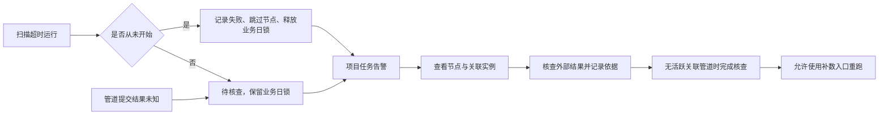

# Data Khaos PaaS 实施计划与 AI 交接

维护者 **dkailab**。本轮优先完成 **PR 2 · 离线任务可补数、可重算、质量通过后才发布**。用订单数仓验证调度、管道和治理能一起工作。仓库的其他分层见[架构与边界](architecture.md)，引擎接入顺序见[平台路线图](big-data-platform-roadmap.md)。

## 当前基线

以 `a3dfc61` 中的实现为规划基线。PR 1 已接通 `JobScheduler → JobExecutor → WorkflowRunner → PipelineNodeExecutor`，可以通过 `scheduleLogId`、`runId`、节点与管道实例定位执行。现有手动触发返回 `R<String>`，工作流异步运行。仓库中的 `db/seed-paas-pr1.sql` 是 MySQL → MySQL 的联调数据。

下一阶段有三个具体缺口。

- **调度**。工作流已有参数 Map，调度没有统一持久化业务日期和可重放的触发标识。补数需要按日期查询，不能从任务的实际启动时间反推日期。
- **管道**。`DbSyncEngine` 采用追加写入，空源直接返回。同日重跑、部分失败恢复、源侧删除后清理旧目标数据都需要独立的按日写入策略。
- **治理**。`DqInternalController` 同步返回快照，当前规则明细的 `passed=0` 也可能来自执行异常。工作流缺少直接消费分区质量结论的执行器。

以下字段为 **PR 2 拟定契约**。跨服务 DTO 放在所属的 `*-api`，尽量复用现有实体、客户端和查询入口。例子展示业务载荷，现有对外 API 仍使用 `R<T>`。

## PR 2A · 触发、业务日期与补数

**负责模块**。`schedule`、`workflow`、`workflow-api` 及运行记录迁移。入口从 `JobScheduler`、`JobExecutor`、`WorkflowController`、`WorkflowService` 和 `WorkflowRunner` 查起。

### 输入与输出

建议新增 `POST /api/workflow/{id}/runs` 接收带日期的手动触发，`POST /api/workflow/{id}/backfills` 接收区间补数。已有 `/{id}/trigger` 继续返回 `R<String>`。定时调用沿用现有受信内部入口，运行详情复用 `GET /api/workflow/run/{runId}`。

| 入口 | 输入 | 输出 |
| --- | --- | --- |
| 带业务日期的手动运行 | 路径中的 `workflowId`，请求体中的 `requestId`、`bizDate` | `{ "runId": "run-101", "bizDate": "2026-11-18" }` |
| 定时运行 | 可信调度调用传入 `scheduleJobId`、`scheduleLogId`、`scheduledAt`，由调度服务生成 `requestId`、`bizDate` | 同上，可用调度日志与运行 ID 关联 |
| 区间补数 | `{ "requestId": "backfill-42", "fromDate": "2026-11-17", "toDate": "2026-11-18" }` | 按日期排序的 `items`，每项含 `bizDate`，成功受理时含 `runId`，受理失败时含 `errorCode` |
| 运行查询 | 已授权的 `runId`，或 `workflowId` + `bizDate` 分页查询 | 已有运行详情增加 `bizDate`、`requestId`、`triggerType`，保留调度关联及运行状态 |

- `bizDate` 使用严格的 `YYYY-MM-DD`，时间边界统一为 `Asia/Shanghai`。订单示例的 cron 在当天处理上一业务日，日期取计划触发时间 `scheduledAt` 在指定时区的日期减一天。延迟执行和重试沿用已确定的日期。带业务日期的手动运行和补数显式传日期。继续支持旧触发入口和已有无日期运行，旧记录的日期字段可为空。
- 补数区间含首尾，首版最多 31 天。先验证整段参数与工作流权限，再按日受理，每日一条运行。即时响应表示受理，最终状态从运行查询获取。若部分日期受理失败，原请求重发时返回已受理的运行并尝试尚未受理的日期。批次键绑定原始区间，按日派生稳定的子请求键。把区间补数限制在用户显式请求内，沿用现有调度扫描策略。
- 为 `(workflowId, requestId)` 建立持久化唯一约束，校验同键请求的规范化参数是否相同。网络重试沿用原键和运行 ID。同键异参返回 `REQUEST_CONFLICT`。有意重算同日使用新键。定时请求键按调度任务与计划触发时刻生成，不能在每次调用时随机生成。只有创建成功的一方提交 DAG 执行，运行行和节点初始行一起持久化。遇到执行器拒绝提交时保留可查询的明确终态，避免长期停在 `PENDING`。
- 示例工作流同一 `workflowId + bizDate` 只允许一条活跃运行，竞争请求返回可查询的 `RUN_ALREADY_ACTIVE` 与活跃运行 ID。采用数据库约束或锁验证并发，确认该次运行及其写入节点均已结束后释放。遇到进程退出或下游提交结果未知时，先根据已记录的关联 ID 核对写入状态，再允许同日重算。交接说明检测与恢复步骤。示例目标分区由这一工作流独占写入。
- 日期通过受控运行上下文传给节点，覆盖规则对旧参数明确。业务日期运行中，节点静态参数不能改写它。跨服务的日期参数按日期类型绑定或由严格校验后的日期生成。

**验收**。时间跨过上海零点后执行，仍得到原计划对应的业务日。并发发送两次相同请求均得到同一个 `runId`。同键异参、无效日期、超范围、跨项目调用、不同键抢占活跃日均有明确结果。模拟两天中第二天受理失败后重发，首日不会重复创建。线程池拒绝后能查到失败并重新发起。旧触发和旧记录仍可用。

## PR 2B · 按日重算订单数仓

**负责模块**。`pipeline`、`pipeline-api`、工作流中的管道节点适配和示例 SQL。接入 PR 2A 的日期上下文，先走仓库已有联调路径，交付 MySQL 测试基线。以新任务配置或显式模式启用，现有 DB-Sync 追加任务沿用原行为。

### 输入与输出

| 位置 | 契约 |
| --- | --- |
| 管道运行输入 | `taskId`、`runId`、`nodeRunId`、`bizDate`。目标表和写入策略取已授权的任务定义，示例模式为 `REPLACE_BY_BIZ_DATE` |
| 读取范围 | 源表日期列等于 `bizDate`，或时间列落在业务日的 `[start, end)` 区间。SQL 转换节点同样读取指定日期 |
| 成功结果 | 已有管道实例 ID、执行终态、行数、目标表标识与实际写入的日期。产出证据只在目标事务提交后返回 |
| 失败结果 | 保留实例 ID、终态及可诊断错误。禁止把失败当作零行成功，后继节点按现有 DAG 语义跳过 |

- 订单链路为源订单 → `ODS` 原始订单 → `DWD` 清洗明细 → `DWS` 日地区汇总 → `ADS` 地区成交额。MySQL 基线用日期列模拟逻辑分区。目标表使用能支持事务的存储引擎，每次写入同一事务内删除当日旧数据并插入当日新结果。读取成功且确认为零行时，提交空分区结果并清理该日旧数据。读取失败时保留原分区。DWD、DWS、ADS 的示例转换遵循相同的按日写入边界。
- 重跑行为定义在单个目标分区内。链路中途失败时，已经提交的上游分区允许保留。PR 2C 负责控制后续 ADS 产出。以已关联的管道实例确认超时发生后的提交状态，沿用 PR 1 的未知提交处理。
- DataX → Hive 的日期过滤、分区覆盖和失败恢复单独在真实环境验收。MySQL 的单库事务语义仅用于该基线。没有 Hive 验收环境时，在交接中把它标为待验证，并附环境依赖与执行命令。

**验收**。种子数据使用合成订单。示例把金额统一为 `DECIMAL`。

| 业务日期 | 源订单 | 预期 ADS |
| --- | --- | --- |
| 2026-11-17 | 华东两笔 `100.00`、`50.00)，华北一笔 `30.00` | 华东 `150.00`，华北 `30.00` |
| 2026-11-18 | 华东一笔 `70.00` | 华东 `70.00` |

对两日逐层断言。先重跑 17 日确认行数与金额一致，再补 18 日确认 17 日结果不变。在删除目标当日数据后注入写入失败，断言回滚后旧分区仍完整。源侧删掉某日全部数据后重算，断言只清理该日对应分区。保留可重复运行的建表、造数和校验脚本。

## PR 2C · 质量门禁与发布

**负责模块**。`dquality`、`dquality-api`、workflow 质量节点执行器与示例 DAG。先读 `DqInternalController`、`TaskService`、`QualityEngine`、`NodeExecutorFactory`。门禁位于 DWS 与 ADS 之间，校验同一业务日源数据和 DWS 汇总的地区金额。

### 输入与输出

```json
{
  "qualityTaskId": "order-daily-reconciliation",
  "runId": "run-101",
  "nodeRunId": "node-401",
  "bizDate": "2026-11-17"
}
```

资产和规则范围由质量任务配置解析，规则的源端和目标端都按同一个 `bizDate` 过滤。质量服务保存能关联到该次节点运行和日期的快照及规则明细，跨服务调用沿用内部身份校验并核对任务的项目范围。

| 门禁结论 | 工作流动作 |
| --- | --- |
| `PASS` | 持久化 `snapshotId`，确认有效阻断规则全部通过，继续 ADS |
| `FAIL` | 保留快照 ID 和失败规则，节点 `FAILED`，ADS 后继 `SKIPPED` |
| `ERROR` | 记录执行异常、超时、无有效规则或结果缺失，节点 `FAILED`，ADS 后继 `SKIPPED`。若已有快照，保留其 ID |

输出包括 `bizDate`、`verdict`、可用时的 `snapshotId`，以及失败时的 `errorCode`。在质量引擎生成结果的地方区分规则不满足和检测过程异常，快照与明细提交完成后才能返回可放行结果。旧的质量任务、历史快照和周期稽核继续使用原有接口和字段。

**验收**。跑通 PR 2B 的双日数据。在示例 DAG 的 DWS 提交后、质量节点开始前注入 17 日金额差异，验证首跑无 ADS 产出，或重跑时已发布的 ADS 结果保持原值，同时运行详情指向失败快照。模拟质量服务超时、规则查询报错、零有效规则，均不能触发 ADS。修复后用新请求重跑，得到新的通过快照和正确结果。

## PR 3 · 运行证据、数据地图与 BI

完成 PR 2 后做。输入为 `runId` 或有权限的 `assetId + bizDate`。运行侧可查询 `runId → nodeRunId → pipelineInstanceId / snapshotId → 输入输出资产及日期`。资产侧从现有数据地图进入，回查该分区最近一次成功发布的运行及质量证据。失败运行也应可查，已发布数据的来源保持指向实际生产该版本的成功运行。

复用 metadata 的资产 ID 和血缘能力。节点声明的表级依赖用于结构血缘，实际的分区发布记录用于追溯。通过现有 mart 指标及 BI 看板展示地区成交额。验收时从看板找到 ADS 分区及其生产运行，再从一次失败运行查看受影响资产。覆盖跨项目访问、查询不到证据、失败后重跑三个路径。前端复用统一产品导航和资产页，不新增独立门户。

后续优先补运维控制台的失败筛选、告警与补数入口，再拿真实 MySQL → Hive 环境完成引擎验收。Spark、Trino、Ranger、CDC 和 PaaS/BI 物理拆仓继续按平台路线图推进。AI 可以先用 PR 3 的运行证据做只读诊断，输出受影响分区、失败原因和证据 ID，实际补数由现有入口执行。

## PR 4 · 工作流中断恢复与项目任务告警

项目运维从运行详情处理超时、失败和待核查的业务日。新节点执行前锁定运行记录并核对状态，恢复扫描通过同一运行状态约束挡住延迟到达的线程。已运行的 DAG 每 15 秒续约，默认 5 分钟无心跳才进入恢复判定。扫描由工作流服务完成。



项目运行列表新增任务告警视图，按运行留存一条告警和确认人。确认告警只改变阅读状态。恢复核查要求项目调度权限和核查说明。存在运行中的关联管道时拒绝解锁。项目为空的旧运行仍会被扫描；项目页面仅处置具有项目归属的运行。详情展示恢复原因、项目内运行 ID 和节点关联实例 ID。

| 入口 | 输入与结果 |
| --- | --- |
| `GET /api/permission/project-group/{id}/workspace/runs` | `alertsOnly=true` 查询失败和待核查工作流。可同时用 `unacknowledgedOnly=true` 筛选待确认告警。 |
| `POST …/workspace/runs/WORKFLOW/{runId}/acknowledge` | 当前项目具有调度权限。重复确认成功，保留首次确认记录。 |
| `POST …/workspace/runs/WORKFLOW/{runId}/resolve-recovery` | 接收 `{"note":"外部执行和写入的核查依据"}`。存在活跃管道时保留待核查和锁，否则记录核查人并释放锁。 |

先执行 `db/migrate-workflow-recovery.sql`，协调更新 workflow、pipeline、permission、schedule 和 Web。升级期间可设置 `WORKFLOW_RECOVERY_ENABLED=false`，旧版 workflow 与 pipeline 停止后再启用扫描。已登记的活跃管道必须先取得终态，核查表单才会释放锁。验收覆盖排队中断、已开始且提交未知、延迟线程、并发扫描、重复确认、跨项目拒绝、活跃管道阻止解锁及解锁后重跑。告警首版由项目站内列表呈现。

## PR 5 · 工作流版本与恢复草稿

数据开发人员可以把已保存的节点、依赖连线和默认参数固化为不可编辑的版本。版本记录包含序号、说明、创建者、时间及节点和依赖数量。并发创建版本时锁定工作流定义，避免图保存到一半或生成重复序号。版本历史按当前工作流及当前项目查询，项目角色需具备 `task:develop`，无项目归属的旧工作流由平台管理员操作。


| 接口 | 输入与输出 |
| --- | --- |
| `POST /api/workflow/{id}/revisions` | 接收 `note`，返回版本元数据。 |
| `GET /api/workflow/{id}/revisions` | 使用 `current` 和 `size` 分页，按版本号降序返回元数据。 |
| `POST /api/workflow/{id}/revisions/{revisionId}/draft` | 接收新工作流 `name`，返回同项目的独立停用草稿。草稿保留节点、连线和参数，生成新编码，排期和负责人可在编排页配置。 |

入口在 **数据开发 → 工作流编排 → 版本**。已有环境先执行 `db/migrate-workflow-revisions.sql`。验证覆盖无权限、跨工作流版本、历史内容独立于后续编辑、同项目停用草稿恢复以及并发生成版本。发布审批、运行绑定发布版本和环境晋级继续沿版本管理推进。

## 发给执行 AI

先派发 **PR 2A**。按 `2A → 2B → 2C → 3` 合并，每次给执行者本文件和上一个 PR 的交接结果。把下面任务中的 PR 编号替换为本次要实现的部分。

> 在 Data Khaos 仓库实施 `docs/paas-implementation-plan.md` 中的 **PR 2A**，维护者 dkailab。先检查 Git 状态，阅读适用的 AGENTS.md、本文件和该 PR 的入口代码。按该节输入、输出、边界和验收开发，保留已有用户改动及老接口。遇到现有契约冲突时，优先保持兼容，并把实际对接方式和差异放进交接。只实现本 PR，完成相关模块构建、测试和失败路径验证后提交交接结果。

每份交接按下面格式返回，供下一位直接接续。

```text
PR 与范围：
入口与契约：实际路径、DTO、成功和失败响应样例
数据库：新增字段、约束、迁移命令、旧数据处理
实测：环境、命令、用例、结果与可核对证据
未验证项：缺少的环境或数据，以及复验步骤
下个 PR：调用入口、实际参数、示例 ID 或造数命令
```
