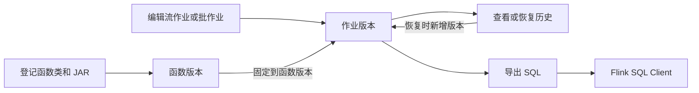

# Flink 开发工作区

维护者 **dkailab**。在同一项目中管理流作业、批作业和 Java/Scala UDF 的注册定义。开发人员可以保存、查看和恢复版本，交付时按指定作业版本导出 Flink SQL。平台保存定义、权限和依赖版本。SQL Client 与 Flink 集群执行导出脚本。

## 功能与流程

- **作业**保存 SQL、运行模式、并行度及具体函数版本。作业脚本中的数据源和目标表由开发者声明。流模式用于无界输入，批模式要求有界输入。导出包含模式、并行度及函数注册语句。SQL 由目标版本的 Flink 校验和解析。运行模式、并行度及函数注册由工作区生成，团队应在正文中避免重复定义。
- **函数**保存稳定的 SQL 标识、显示名称、JVM 类名、Java/Scala 类型及可选 JAR 定位符。未填写 JAR 时，执行环境须已有该函数类。使用版本化或内容寻址的 JAR 文件，避免同一路径上的文件被替换。工作区只保存注册信息，函数源码和编译由制品流程管理。
- **版本**每次新建、编辑或恢复追加一条不可改写的记录。展示版本号、作者、时间和说明。编辑和恢复提交调用方看到的当前版本号，同一版本的并发编辑只允许一次成功。函数升级不影响引用了旧版本的作业。历史记录可展开查看 SQL 或函数注册配置。
- **授权**所有接口按当前项目的 `task:develop` 权限执行。作业只可引用同项目的函数版本。SQL 文本可含集群连接定义，使用平台或运行环境的密钥引用规范。
- **部署边界**集群接入需配置许可的连接器与制品库、凭据注入、运行身份、发布审批和 checkpoint/savepoint 策略。保存、恢复和导出属于开发操作，手动运行另需调度权限。

## 接口

根路径为 `/api/workflow/flink/projects/{projectId}/assets`。

| 方法 | 输入 | 输出 |
| --- | --- | --- |
| `GET /` | `kind=JOB\|FUNCTION`、分页、关键字 | 当前资产摘要 |
| `POST /` | 类型、稳定编码、名称、说明和定义 | 初始版本 |
| `PUT /{id}/draft` | 名称、定义、说明和 `expectedVersion` | 新版本 |
| `GET /{id}/versions` | 分页 | 版本摘要 |
| `GET /{id}/versions/{version}` | 正整数版本号 | 完整版本 |
| `POST /{id}/versions/{version}/restore` | 恢复说明、`expectedVersion` | 新版本 |
| `GET /{id}/versions/{version}/sql` | 作业版本号 | 完整 SQL 文本，可交给 Flink SQL Client |

作业的 `definition` 包含 `mode`（`STREAMING` 或 `BATCH`）、`parallelism`、`sql` 和 `functions: [{assetId, version}]`。函数的 `definition` 包含 `language`（`JAVA` 或 `SCALA`）、`className`、可选的 `jarUri`。

按照 Flink 1.20 SQL Client 的运行模式和 UDF 注册语法生成脚本。 [运行模式](https://nightlies.apache.org/flink/flink-docs-release-1.20/docs/dev/table/sqlclient/) · [CREATE FUNCTION](https://nightlies.apache.org/flink/flink-docs-release-1.20/docs/dev/table/sql/create/#create-function)

## 发布与验收

已有 MySQL 环境先执行 `db/migrate-flink-studio.sql`。入口为 **数据开发 → Flink 开发**。验收覆盖同项目作业与函数维护、并发编辑、跨项目拒绝、旧函数引用和历史恢复。

离线对账样例使用 Flink 批模式读取固定时点的有界 MySQL 快照，复用流作业的支付、时区、金额与分组口径，写入独立对账表。流式结果和批结果逐键比对。 [实时数仓样例](realtime-warehouse.md)

## 手动提交与运行记录

有开发和调度权限的项目成员可在作业历史中选择固定版本并提交。管理员通过部署配置将一个项目绑定到专用 SQL Gateway 和 JobManager REST。默认关闭。SQL Gateway 只接收该项目审核信任的开发人员提交的 SQL。专用运行环境使用独立身份、连接器、制品访问和网络范围。

首版接收会话内的 `CREATE TEMPORARY TABLE/VIEW/FUNCTION`、受支持的 `SET` 和最后一条 `INSERT INTO`。在现有历史版本界面可查看运行记录、引擎 Job ID 和最新状态。集群绑定确认后，在 workflow 服务配置 `FLINK_RUN_PROJECT_ID`、`FLINK_RUN_SQL_GATEWAY`（如 `http://flink-sql-gateway:8083`）和 `FLINK_RUN_JOBMANAGER`（如 `http://flink-jobmanager:8081`）。先执行 `db/migrate-flink-deployment.sql`。

接口以 `/api/workflow/flink/projects/{projectId}/assets/{id}` 为根：

| 方法 | 输入与结果 |
| --- | --- |
| `GET /runs` | 分页查看作业版本、提交人、状态和引擎 Job ID，返回项目提交功能是否启用。 |
| `POST /versions/{version}/runs` | 请求体 `requestId` 为 UUID。先登记运行，同键同版本重试复用原记录。同一作业只允许一条未终止运行。 |
| `POST /runs/{runId}/refresh` | 按已知 Job ID 或唯一运行名称回查并记录状态。 |
| `POST /runs/{runId}/cancel` | 向已确认的引擎 Job ID 发送取消请求，再通过刷新确认终态。 |

提交前准备失败可以新开请求。发送 INSERT 后结果不明确时进入待核查，保留活动运行锁，通过集群回查补齐。引擎失联时保留上一次确认的状态。集群地址配置变化后，已有运行需要恢复原绑定才能继续处置。定时调度、发布审批和批次参数留在后续交付。 [SQL Gateway REST](https://nightlies.apache.org/flink/flink-docs-release-1.20/docs/dev/table/sql-gateway/rest/) · [JobManager REST](https://nightlies.apache.org/flink/flink-docs-release-1.20/docs/ops/rest_api/)

### 保存停机与断点恢复

正在运行的流作业可选择「保存停机」。JobManager 写入 canonical savepoint 并停止旧作业，平台确认保存点和终态后释放活动运行锁。停机采用 `drain=false`，保留未触发的事件时间窗口计时器。发起需要项目开发与调度权限，重复请求沿用同一引擎触发 ID。JobManager 与 TaskManager 使用双方可读写的 `execution.checkpointing.savepoint-dir`。

| 操作 | 接口 |
| --- | --- |
| 保存停机 | `POST /runs/{runId}/stop`，随后用刷新接口确认停机和保存点 |
| 从断点恢复 | `POST /runs/{runId}/resume`，传入新的 UUID `requestId`，从原运行保存点提交同一作业版本，并记录来源运行 |

恢复地址由 JobManager 返回并由平台内部留存。接口以原运行 ID 为入口，按项目及所属集群校验。恢复仍受单作业活动锁保护，原版本的 SQL 和函数依赖保持固定。常规 checkpoint 故障恢复由 Flink 自身执行。 [Flink Savepoints](https://nightlies.apache.org/flink/flink-docs-release-1.20/docs/ops/state/savepoints/)

### 检查点诊断

在「运行与记录」中，对已取得引擎 Job ID 的运行点击「检查点」。页面按需读 JobManager，展示已完成、失败、进行中及恢复次数，列出最近 12 条检查点的类型、状态、触发时间、耗时和大小，并标出最近恢复使用的检查点或保存点。接口为 `GET /runs/{runId}/checkpoints`，需要项目开发权限及当前集群绑定。引擎保留的记录范围决定可查询的历史。 [Flink 检查点监控](https://nightlies.apache.org/flink/flink-docs-release-1.20/docs/ops/monitoring/checkpoint_monitoring/)

### 执行节点运行指标

进入 **Flink 开发 → 历史版本 → 运行与记录 → 运行指标**，选择要排查的执行节点。页面展示节点状态和并行度，以及可采集到的输入输出吞吐、最高反压比例、平均忙碌和空闲比例、最慢输入水位线。一个 Flink 执行节点可能包含多个链式算子。

`GET /runs/{runId}/metrics` 返回 `vertices`、`selectedVertexId` 和 `sample`。可选参数 `vertexId` 只接受该运行的执行节点 ID，缺省选第一个节点。访问要求与检查点一致。每次请求只读取所选节点的聚合样本。吞吐为可用子任务的速率之和，反压取最大值，忙碌和空闲取平均值，输入水位线取最小值。无样本的指标显示为「—」，实际零值正常展示。查询时间为平台读取样本的时间。 [Flink 指标说明](https://nightlies.apache.org/flink/flink-docs-release-1.20/docs/ops/metrics/)
