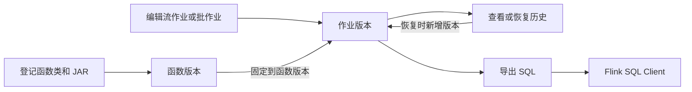

# Flink 开发工作区

维护者 **dkailab**。在同一项目中管理流作业、批作业和 Java/Scala UDF 的注册定义。开发人员可以保存、查看和恢复版本，交付时按指定作业版本导出 Flink SQL。平台保存定义、权限和依赖版本。SQL Client 与 Flink 集群执行导出脚本。

## 功能与流程

- **作业**保存 SQL、运行模式、并行度及具体函数版本。作业脚本中的数据源和目标表由开发者声明。流模式用于无界输入，批模式要求有界输入。导出包含模式、并行度及函数注册语句。SQL 由目标版本的 Flink 校验和解析。运行模式、并行度及函数注册由工作区生成，团队应在正文中避免重复定义。
- **函数**保存稳定的 SQL 标识、显示名称、JVM 类名、Java/Scala 类型及可选 JAR 定位符。未填写 JAR 时，执行环境须已有该函数类。使用版本化或内容寻址的 JAR 文件，避免同一路径上的文件被替换。工作区只保存注册信息，函数源码和编译由制品流程管理。
- **版本**每次新建、编辑或恢复追加一条不可改写的记录。展示版本号、作者、时间和说明。编辑和恢复提交调用方看到的当前版本号，同一版本的并发编辑只允许一次成功。函数升级不影响引用了旧版本的作业。历史记录可展开查看 SQL 或函数注册配置。
- **授权**所有接口按当前项目的 `task:develop` 权限执行。作业只可引用同项目的函数版本。SQL 文本可含集群连接定义，使用平台或运行环境的密钥引用规范。
- **部署边界**集群接入需配置许可的连接器与制品库、凭据注入、运行身份、发布审批和 checkpoint/savepoint 策略。保存、恢复和导出属于开发操作，手动运行另需调度权限。

## 接口

根路径为 `/api/workflow/flink/projects/{projectId}/assets`。

| 方法 | 输入 | 输出 |
| --- | --- | --- |
| `GET /` | `kind=JOB\|JAR_JOB\|FUNCTION`、分页、关键字 | 当前资产摘要 |
| `POST /` | 类型、稳定编码、名称、说明和定义 | 初始版本 |
| `PUT /{id}/draft` | 名称、定义、说明和 `expectedVersion` | 新版本 |
| `GET /{id}/versions` | 分页 | 版本摘要 |
| `GET /{id}/versions/{version}` | 正整数版本号 | 完整版本 |
| `POST /{id}/versions/{version}/restore` | 恢复说明、`expectedVersion` | 新版本 |
| `GET /{id}/versions/{version}/sql` | 作业版本号 | 完整 SQL 文本，可交给 Flink SQL Client |

SQL 作业的 `definition` 包含 `mode`（`STREAMING` 或 `BATCH`）、`parallelism`、`sql` 和 `functions: [{assetId, version}]`。函数的 `definition` 包含 `language`（`JAVA` 或 `SCALA`）、`className`、可选的 `jarUri`。

按照 Flink 1.20 SQL Client 的运行模式和 UDF 注册语法生成脚本。 [运行模式](https://nightlies.apache.org/flink/flink-docs-release-1.20/docs/dev/table/sqlclient/) · [CREATE FUNCTION](https://nightlies.apache.org/flink/flink-docs-release-1.20/docs/dev/table/sql/create/#create-function)

## 发布与验收

已有 MySQL 环境先执行 `db/migrate-flink-studio.sql`。入口为 **数据开发 → Flink 开发**。验收覆盖同项目作业与函数维护、并发编辑、跨项目拒绝、旧函数引用和历史恢复。

离线对账样例使用 Flink 批模式读取固定时点的有界 MySQL 快照，复用流作业的支付、时区、金额与分组口径，写入独立对账表。流式结果和批结果逐键比对。 [实时数仓样例](realtime-warehouse.md)

## 手动提交与运行记录

有开发和调度权限的项目成员可在作业历史中选择固定版本并提交。管理员通过部署配置将一个项目绑定到专用 SQL Gateway 和 JobManager REST。默认关闭。SQL Gateway 只接收该项目审核信任的开发人员提交的 SQL。专用运行环境使用独立身份、连接器、制品访问和网络范围。

首版接收会话内的 `CREATE TEMPORARY TABLE/VIEW/FUNCTION`、受支持的 `SET` 和最后一条 `INSERT INTO`。在现有历史版本界面可查看运行记录、引擎 Job ID 和最新状态。集群绑定确认后，在 workflow 服务配置 `FLINK_RUN_PROJECT_ID`、`FLINK_RUN_SQL_GATEWAY`（如 `http://flink-sql-gateway:8083`）和 `FLINK_RUN_JOBMANAGER`（如 `http://flink-jobmanager:8081`）。先执行 `db/migrate-flink-deployment.sql`。

接口以 `/api/workflow/flink/projects/{projectId}/assets/{id}` 为根：

| 方法 | 输入与结果 |
| --- | --- |
| `GET /runs` | 分页查看作业版本、提交人、状态和引擎 Job ID，返回项目提交功能是否启用。 |
| `POST /versions/{version}/runs` | 请求体 `requestId` 为 UUID。先登记运行，同键同版本重试复用原记录。同一作业只允许一条未终止运行。 |
| `POST /runs/{runId}/refresh` | 按已知 Job ID 或唯一运行名称回查并记录状态。 |
| `POST /runs/{runId}/cancel` | 向已确认的引擎 Job ID 发送取消请求，再通过刷新确认终态。 |

提交前准备失败可以新开请求。发送 INSERT 后结果不明确时进入待核查，保留活动运行锁，通过集群回查补齐。引擎失联时保留上一次确认的状态。集群地址配置变化后，已有运行需要恢复原绑定才能继续处置。定时调度、发布审批和批次参数留在后续交付。 [SQL Gateway REST](https://nightlies.apache.org/flink/flink-docs-release-1.20/docs/dev/table/sql-gateway/rest/) · [JobManager REST](https://nightlies.apache.org/flink/flink-docs-release-1.20/docs/ops/rest_api/)

### 保存停机与断点恢复

正在运行的流作业可选择「保存停机」。JobManager 写入 canonical savepoint 并停止旧作业，平台确认保存点和终态后释放活动运行锁。停机采用 `drain=false`，保留未触发的事件时间窗口计时器。发起需要项目开发与调度权限，重复请求沿用同一引擎触发 ID。JobManager 与 TaskManager 使用双方可读写的 `execution.checkpointing.savepoint-dir`。

| 操作 | 接口 |
| --- | --- |
| 保存停机 | `POST /runs/{runId}/stop`，随后用刷新接口确认停机和保存点 |
| 从断点恢复 | `POST /runs/{runId}/resume`，传入新的 UUID `requestId`，从原运行保存点提交同一作业版本，并记录来源运行 |

恢复地址由 JobManager 返回并由平台内部留存。接口以原运行 ID 为入口，按项目及所属集群校验。恢复仍受单作业活动锁保护，原版本的 SQL 和函数依赖保持固定。常规 checkpoint 故障恢复由 Flink 自身执行。 [Flink Savepoints](https://nightlies.apache.org/flink/flink-docs-release-1.20/docs/ops/state/savepoints/)

### 检查点诊断

在「运行与记录」中，对已取得引擎 Job ID 的运行点击「检查点」。页面按需读 JobManager，展示已完成、失败、进行中及恢复次数，列出最近 12 条检查点的类型、状态、触发时间、耗时和大小，并标出最近恢复使用的检查点或保存点。接口为 `GET /runs/{runId}/checkpoints`，需要项目开发权限及当前集群绑定。引擎保留的记录范围决定可查询的历史。 [Flink 检查点监控](https://nightlies.apache.org/flink/flink-docs-release-1.20/docs/ops/monitoring/checkpoint_monitoring/)

### 执行节点运行指标

进入 **Flink 开发 → 历史版本 → 查看 → 运行与记录 → 运行指标**，选择要排查的执行节点。页面展示节点状态和并行度，以及可采集到的输入输出吞吐、最高反压比例、平均忙碌和空闲比例、最慢输入水位线。一个 Flink 执行节点可能包含多个链式算子。

`GET /runs/{runId}/metrics` 返回 `vertices`、`selectedVertexId` 和 `sample`。可选参数 `vertexId` 只接受该运行的执行节点 ID，缺省选第一个节点。访问要求与检查点一致。每次请求只读取所选节点的聚合样本。吞吐为可用子任务的速率之和，反压取最大值，忙碌和空闲取平均值，输入水位线取最小值。无样本的指标显示为「—」，实际零值正常展示。查询时间为平台读取样本的时间。 [Flink 指标说明](https://nightlies.apache.org/flink/flink-docs-release-1.20/docs/ops/metrics/)

「算子指标」按 Flink 算子名展示最慢输入和输出水位线。支持的源连接器展示待取记录数，汇总可用子任务的 `pendingRecords`。Kafka 源还展示最大分区积压，取各子任务 `records-lag-max` 的最大值。该值基于消费者当前读取偏移表示采样窗口内最慢分区的积压，消费组已提交偏移需另行查询。水位线与积压不可用时显示「—」。长算子链可能只展示部分算子指标，页面会提示。 [Flink Kafka 指标](https://nightlies.apache.org/flink/flink-docs-release-1.20/docs/connectors/datastream/kafka/#monitoring) · [Kafka 消费指标](https://kafka.apache.org/39/operations/monitoring/#consumer-monitoring)

### 函数库与 JAR 作业

进入 **数据开发 → Flink 开发 → 函数库**，登记标量函数 `UDF`、表值函数 `UDTF` 或聚合函数 `UDAF`。分类随版本保存，历史未分类函数可以在下一版补录。标量函数返回一个值，表值函数可通过 `LATERAL TABLE` 展开为多行，聚合函数按组计算。Flink 根据 JVM 实现类解析 SQL 签名和类型，平台保存登记信息。SQL 作业继续绑定具体函数版本。 [Flink SQL 自定义函数](https://nightlies.apache.org/flink/flink-docs-release-1.20/docs/dev/table/functions/udfs/)

进入 **Flink 开发 → JAR 作业** 新建版本，填写集群 JAR ID、入口类、流批模式、并行度和逐项启动参数。API 使用 `kind=JAR_JOB`，定义为 `{mode, parallelism, jarJob: {jarId, entryClass, arguments}}`。首期运行 Flink REST 可接受的单作业 JAR。运行模式与并行度由平台作为默认配置提交，应用代码显式设置可以覆盖。作业版本和运行记录复用已有表，无额外数据库迁移。

部署时由管理员向绑定的 Flink JobManager 上传经过审核的、带版本的 JAR，从 `GET /jars` 获取制品 ID，并在 workflow 服务配置 `FLINK_RUN_ALLOWED_JARS`，多个 ID 以逗号分隔。配置 `FLINK_RUN_PROJECT_ID` 与 `FLINK_RUN_JOBMANAGER` 即可运行 JAR 作业，SQL 作业另需 SQL Gateway。JAR 更换或重新上传会生成新 ID，应保存为新作业版本。需重放的旧版 JAR 要保留在集群的上传目录内。启动参数随版本保存，凭据通过运行环境注入。 [Flink JAR 上传与运行接口](https://nightlies.apache.org/flink/flink-docs-release-1.20/docs/ops/rest_api/#jarsjaridrun)

在具体版本中打开「运行与记录」并提交，沿用项目开发和调度权限、请求幂等及活动运行互斥。JAR 请求携带固定引擎 Job ID，提交结果不明确时，刷新按该 ID 回查。流式 JAR 使用已有保存停机入口，恢复时复用原版本并将保存点交给 Flink。作业需具备兼容的状态和算子 UID。

### 检查点持续告警

为已有 MySQL 库执行 `db/migrate-flink-checkpoint-alert.sql`，再给 workflow 服务配置 `FLINK_CHECKPOINT_ALERT_ENABLED=true`。新建 Compose 库会自动执行迁移。巡检每批检查最多 20 条已确认引擎 ID 的运行，批次间隔 30 秒，按运行 ID 轮转。SQL 与 JAR 作业共用规则。

最近三个已结束的普通检查点均失败时开启告警。开启后继续记录最近失败检查点，后续成功检查点关闭告警并记为恢复。运行结束时关闭当前告警并记为作业结束。保存点以及未完成的检查点不参与判断。引擎读不到时保留当前状态。平台按检查点 ID 去重，服务重启后继续使用已保存的记录。规则使用 Flink 当前可读取的检查点历史，巡检间隔内被引擎淘汰的失败记录可能无法观测。

在 **运行与记录 → 检查点 → 检查点告警** 查看最近 30 条告警。接口 `GET /runs/{runId}/checkpoint-alerts` 沿用运行所属项目的开发权限，读取历史记录无需引擎在线。作业页面保留告警详情。

### 检查点告警站内通知

执行 `db/migrate-flink-alert-notification.sql`，在 workflow 和 notification 服务中配置相同的 `FLINK_ALERT_NOTIFICATION_TOKEN`。新建 Compose 库会自动执行迁移。令牌由部署环境提供，内部投递地址走服务发现。检查点巡检还需启用 `FLINK_CHECKPOINT_ALERT_ENABLED=true`。

告警开启或恢复时，系统向该运行的提交人发送一条站内消息。点击页面右上角的铃铛查看个人收件箱。运行结束只是关闭巡检记录。启用通知后产生的事件与告警事务一起保存。通知服务暂时不可用时系统自动重试，同一告警先送达开启通知再送达恢复通知，重复投递共用同一条消息记录。启用前已产生的历史告警不回补。

### 持续反压告警

已有 MySQL 库执行 `db/migrate-flink-pressure-alert.sql`，然后在 workflow 服务配置 `FLINK_PRESSURE_ALERT_ENABLED=true`。新建 Compose 库自动执行迁移。巡检每批最多读取 20 个作业，每个作业通过一次 JobManager 请求取得各执行节点的累计反压耗时。SQL 和 JAR 作业共用规则。 [Flink JobManager REST](https://nightlies.apache.org/flink/flink-docs-release-1.20/docs/ops/rest_api/#jobsjobid)

按两次采样之间的反压耗时增量计算各节点的子任务平均反压比例。连续三个采样区间的最高节点反压均达到 50% 时告警，所有在运行节点连续两个区间降到 20% 或以下时恢复。采样至少间隔 20 秒，超过 120 秒重新建立基线。计数重置、并行度改变或节点缺少指标时，该节点当前区间无法用于确认恢复。作业结束会关闭未恢复的告警。

在 **运行与记录 → 运行指标 → 持续反压告警** 查看峰值节点、比例和最近 30 条状态记录。接口为 `GET /runs/{runId}/pressure-alerts`。配置站内通知后，系统会将告警和恢复发送给作业提交人。

### Kafka 积压告警

为已有 MySQL 库执行 `db/migrate-flink-kafka-alert.sql`，再在 workflow 服务配置 `FLINK_KAFKA_ALERT_ENABLED=true`。新建 Compose 库自动执行迁移。进入 **运行与记录 → 运行指标**，选择上报 Kafka 最大分区积压指标的执行节点，设置告警阈值和更低的恢复阈值后启用。每条运行可配置一条规则，修改阈值或切换监控节点前先停用，旧告警记录仍可查看。新运行需要单独配置规则。

规则使用 Flink 上报的 `records-lag-max`，取该节点已发现的 Kafka 算子中的最大值，单位为条。它基于消费者当前读取偏移。连续三个有效样本达到告警阈值时开启告警，连续两个有效样本降到恢复阈值时恢复。零值是有效样本，指标缺失、连接中断或有指标未返回时本轮无法确认恢复。启用站内通知后，作业提交人会收到告警及恢复消息。 [Kafka 消费指标](https://kafka.apache.org/39/operations/monitoring/#consumer-monitoring)

开发权限允许查询 `GET /runs/{runId}/kafka-alerts`。同时具备开发和调度权限可通过同一路径的 `PUT` 启用或停用规则，启用参数为 `{enabled, vertexId, highThreshold, lowThreshold}`，停用只需 `{enabled: false}`。

### 水位线停滞诊断

在 **运行与记录 → 运行指标 → 水位线停滞诊断** 选择正在运行的下游节点并开始观测。每次请求读取该节点的完整输入计数和最慢输入水位线，每隔 15 秒发起下一次采样，最多 12 次。停止观测或关闭弹窗后取消采样，切换节点重新建立基线。界面展示各次采样的水位线、相对采样时刻的滞后、输入增量和诊断。接口为 `GET /runs/{runId}/event-time?vertexId=...`，沿用项目开发权限。 [Flink 事件时间排查](https://nightlies.apache.org/flink/flink-docs-release-1.20/ops/debugging/debugging_event_time.html)

连续三个有效区间有新输入且最慢水位线不变时显示持续停滞。完全无新增输入且水位线不变时显示未观察到新输入。节点重启、并行度变化、计数回退、采样中断或指标不完整时重新判断，不把缺失数据当成零值。部分分区空闲可能阻塞其他活跃分区的水位线，排查时需结合事件时间字段、分区空闲配置和反压。此功能是按需诊断，观测记录保留在当前弹窗。 [Flink 空闲分区](https://nightlies.apache.org/flink/flink-docs-release-1.20/docs/dev/table/concepts/time_attributes/) · [阿里云 Flink 指标](https://help.aliyun.com/zh/flink/realtime-flink/user-guide/metrics)

### 水位线后台巡检

已有 MySQL 库执行 `db/migrate-flink-event-time-alert.sql`，然后在 workflow 服务配置 `FLINK_EVENT_TIME_ALERT_ENABLED=true`。在 **运行与记录 → 运行指标 → 水位线巡检与告警** 选中上报输入计数和水位线的运行节点，再启用巡检。每条运行可启用一个节点，切换前先停用。关闭浏览器后仍继续巡检。

后台轮询间隔为 30 秒，每批最多轮询 12 条运行。连续三个有效区间有输入但水位线不变时告警。后续有效样本确认推进且超过停滞位置时恢复。空闲、指标缺失、采样间隔超过 120 秒或节点执行尝试变化会中断连续判定。作业或节点结束与手动停用单独记录。开通站内通知后，告警和恢复发送给作业提交人。

每条运行最多保留 120 条后台样本和最近 30 条告警供页面查询。GET `/runs/{runId}/event-time-alerts` 读取历史。PUT 同一路径提交 `{enabled, vertexId}`，停用可省略节点 ID。读取需要项目开发权限，配置还需项目调度权限。
