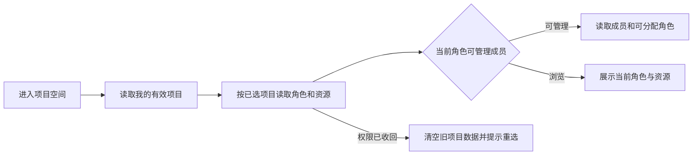
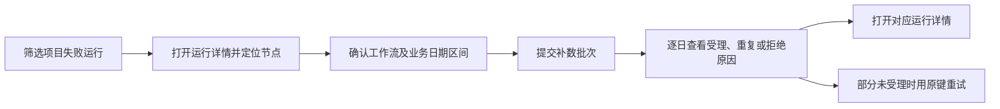

# 功能设计 · PaaS 项目空间隔离

维护者 **dkailab** · v0.1 待评审

[PRD 与验收目标](project-workspace-prd.md)定义用户行为。开工时以已合并的 PR 2A–3 接口为准，先确认调度、工作流、管道和运行证据的实际入口及迁移版本。

## UI 原型

直接用浏览器打开[可点击 HTML 原型](../../prd/project-workspace-prototype.html)。原型使用合成数据，支持离线查看。顶部「原型场景」用于评审时切换角色和异常状态。

| 操作 | 页面反馈 | 验收 |
| --- | --- | --- |
| 在顶部切换零售数仓与营销分析 | 项目名称、角色、列表、筛选和数据源一起刷新。使用者可读，隐藏新建、编辑与运行操作。 | A1、A2、A3 |
| 编辑任务后尝试切换项目 | 弹窗提供继续编辑与放弃修改。继续保留内容，放弃清理草稿后切换。 | A1 |
| 打开任务详情 | 侧滑面板展示项目、任务标识、运行 ID、状态和业务日期。允许执行的角色可手动运行。 | A2、A3、A4 |
| 切换到撤权、无项目、空项目或服务失败场景 | 撤权清空旧项目内容并引导重选。空项目按权限提供创建入口。服务失败保留重试入口。 | A1、A5 |

正式页面使用[平台共享主题和组件](../paas-ui-design.md)。原型的本地场景切换和模拟运行仅面向评审，生产状态由实际 API 决定。

## 已落地的项目空间入口

从 **数据开发 → 项目空间** 进入。项目选择写入当前标签页 URL 的 `project` 参数。未指定项目时优先进入主项目，指定项目已失效时显示重选入口。页面实时读取项目角色、资源绑定和数据源名称及可用状态。具备 `pg:manage` 的成员可以维护当前项目的成员角色，角色只能来自当前项目或符合组织范围的模板。平台管理员负责项目创建、角色定义和资源绑定。成员变更按项目加锁，直接绑定记录沿用现有数据库表。



实际接口使用 `GET /api/permission/project-group/me`、`GET /api/permission/project-group/{id}/workspace`、`GET /api/permission/project-group/{id}/workspace/resources`，以及单成员 `PUT/DELETE /api/permission/project-group/{id}/members/{userId}`。项目管理接口校验登录令牌，permission 与网关需使用同一个 `JWT_SECRET`。此阶段没有数据库迁移。通过 `mvn -o -pl data-khaos-permission -am package` 和 Web 构建验证。任务列表及运行摘要接入见下一节。

## 已落地的任务列表与运行摘要

项目空间中新增「任务列表」与「运行记录」。两页复用当前工作区选择。任务可按名称和类型筛选，运行可按业务日期和类型筛选。两者在服务侧先校验项目成员，再按项目过滤和分页。读模型从当前共享元数据库读取展示列。执行、日志及结果仍由所属服务提供。

| 接口 | 输入 | 输出 |
| --- | --- | --- |
| `GET /api/permission/project-group/{id}/workspace/tasks` | 项目、分页、可选 `kind` 与 `keyword` | 工作流和管道的 ID、名称、类型、状态和更新时间 |
| `GET /api/permission/project-group/{id}/workspace/runs` | 项目、分页、可选 `kind` 与 `bizDate` | 运行 ID、任务标识、状态、业务日期、开始时间、耗时和触发类型 |

类型取值为 `WORKFLOW` 或 `PIPELINE`。运行按受理时写入的 `project_group_id` 查询。没有归属的历史记录留待管理员依据执行证据核对。管道任务调整归属后，原项目仍可查看原运行摘要，任务名称无法确认时显示任务 ID。运行摘要只提供状态和关联标识。

已有 MySQL 数据卷需先完成适用的 PR 2A、2B 迁移，再执行 [项目空间运行归属迁移](../../db/migrate-project-workspace-activity.sql)。之后更新 permission、workflow、pipeline 和 Web。新建数据卷由 Compose 按序应用迁移。任务与运行详情、手工入口的项目角色校验见下一节。测试环境优先使用本地 Maven 与 H2。

## 已落地的详情与手工受理权限

在项目空间的任务或运行列表点击「详情」，抽屉显示任务基本信息、绑定的数据源名称或工作流节点。运行详情按执行时的项目归属读取，展示业务日期、时间、耗时和工作流节点状态。接口只返回展示字段。

| 接口或入口 | 项目校验与输出 |
| --- | --- |
| `GET /api/permission/project-group/{id}/workspace/tasks/{kind}/{taskId}` | 当前用户是任务所属项目成员，返回任务与节点摘要。 |
| `GET /api/permission/project-group/{id}/workspace/runs/{kind}/{runId}` | 当前用户是运行归属项目成员，返回运行和节点状态摘要。 |
| 既有工作流手工执行 | 项目工作流要求该项目的 `task:develop`。带业务日期的运行继续返回原受理结构及运行 ID。 |
| 既有工作流区间补数 | 项目工作流要求该项目的 `task:schedule`。按日受理及重复请求语义沿用 PR 2A。 |
| 既有工作流定义写入 | 保存及删除要求 `task:develop`，调整启用状态或 Cron 还需 `task:schedule`。已经归属项目的任务只能经管理员迁移流程改变归属。 |

工作流服务通过有超时的权限客户端查询有效会话在任务归属项目中的角色。如果请求提供 `X-Project-Group-Id`，它必须与实际任务归属一致。撤权和权限服务异常会阻挡受理。工作流的 8093 端口在 Compose 中仅绑定本机，应用客户端走网关，服务间调用走容器网络。

工作流已实现受理时的角色门槛。工作流执行端的任务引用、数据源凭据、质量和脚本权限，以及调度与排队开始时复核，仍需独立联调。管道的执行入口见下一节。

## 项目运行巡检与补数

运行列表支持组合筛选项目内任务类型、状态、业务日期、任务 ID 与触发类型。失败工作流详情可预填原业务日期进入补数，任务详情也可按区间提交。页面按项目角色显示入口，服务端仍逐次调用现有工作流权限校验。



| 入口 | 输入 | 输出 |
| --- | --- | --- |
| 项目运行列表 | 原分页参数加可选 `status`、`taskId`、`triggerType` | 筛选后分页，项目归属使用运行记录中的快照。 |
| 工作流补数 | `POST /api/workflow/{id}/backfills`，选中项目头、`requestId`、`fromDate`、`toDate` | 最多 31 天，按日期返回受理状态、运行 ID 或拒绝原因。新运行标记为 `BACKFILL`。 |

部分受理和请求结果未知时，从同一项目、任务和日期范围继续使用原请求键。在同一会话页刷新后也可重试。只有用户明确开始新批次才会重算已受理的日期。历史运行继续使用原有触发类型。验收覆盖项目隔离、组合筛选、无效参数、角色限制、网络重试和按日详情。

## 项目空间管道手工运行

在项目任务列表打开已有管道的详情，选业务日期并提交运行。首版支持 MySQL 到 MySQL 的 DB-Sync 按日覆盖。执行使用已保存的数据源、表、日期列和写入策略。源和目标使用同名业务日期列，源端只读该日，目标端在一个事务内覆盖该日。接口接收请求 ID 与业务日期，返回运行 ID 和受理状态。


项目成员须具备 `task:develop` 或 `pipeline:run`。源表需项目 `SELECT`，目标表需项目 `INSERT` 和 `DELETE`。首版以整表授权执行，有适用行列策略的表留给能验证策略等效性的运行方式。代码拒绝自定义源 SQL、字段重映射和非按日覆盖策略。受理与执行前都校验。任务配置在等待期间发生变化时，需要按新定义重新提交。

`POST /api/pipeline/workspaces/{projectId}/tasks/{taskId}/runs` 接收 `{ "requestId": "<UUID>", "bizDate": "YYYY-MM-DD" }`。返回运行 ID、业务日期、`ACCEPTED`、`DUPLICATE` 或 `REJECTED` 受理状态和实例状态。客户端用相同请求 ID 重试未确认的请求。运行列表和详情沿用项目空间的只读接口，项目入口产生的失败原因由后端过滤后展示。

同人同任务的同一请求键重发时复用实例，日期不同返回请求冲突。同一目标表与业务日同时只允许一个项目空间实例写入。排队拒绝和执行失败均保留实例并释放互斥。进程中断留下的未确认实例由运维核对数据库写入状态后处置。工作流、调度和传统管道入口的执行侧隔离继续单独接入。

目标必须是 InnoDB 基础表。源端按业务日读取，最多 100000 行。源端超限、表不符合要求或目标写入失败时，目标旧数据保留。数据库连接账号应限制到项目允许的表，唯一键使用配置中的目标连接地址、默认库、表名和日期。在平台配置中应将同一目标统一绑定到同一 endpoint 地址。

现有 MySQL 数据卷在 [运行归属迁移](../../db/migrate-project-workspace-activity.sql)后，执行[项目管道受理迁移](../../db/migrate-project-workspace-pipeline-run.sql)。更新 pipeline、permission 和 Web。pipeline 与网关使用相同的 `JWT_SECRET`。本地验证使用 `mvn -o -pl data-khaos-pipeline,data-khaos-permission -am package`，前端使用 `npm --prefix data-khaos-web run build`。

## 1. 复用与归属

| 对象 | 落点 |
| --- | --- |
| 项目、成员、能力、资源绑定 | permission 管理既有 `sg_project_group`、`sg_project_group_member`、`sg_project_role`、`sg_project_group_resource`。校验成员、项目状态和角色范围。主项目用于初次选择。 |
| 工作流与管道定义 | workflow 使用现有 `projectId`，pipeline 使用现有 `projectGroupId`。跨服务语义统一为同一个项目 ID。创建时落库，更新时保持归属。 |
| 调度与运行记录 | schedule 记录所引用任务的项目，运行记录保留执行受理时的归属。关联 ID、`bizDate` 和补数请求幂等规则沿用已交付契约。 |
| 数据源 | 沿用 datasource 连接定义，permission 管理项目绑定。首版允许经管理员显式绑定复用连接。实际数据读写还需核对执行主体在目标库表的权限，项目绑定只赋予引用资格。 |
| 页面 | 顶部项目选择器与当前业务导航共用 UI 壳。项目组管理复用现有页面。项目变化后清理旧项目的选择、分页与结果，丢弃仍在途的旧项目响应。 |

现有入口从 `ProjectGroupController`、`ProjectGroupService`、`PipelineAuthContext`、`WorkflowService`、`JobExecutor` 和对应服务的运行查询开始。工作流、管道和调度是首批接入模块。OneSQL、资产目录、质量管理及 BI 接入各自评审。执行已配置质量门禁时，校验引用任务与工作流的归属一致。

## 2. 接口约定

| 调用 | 输入 | 输出与行为 |
| --- | --- | --- |
| 列出我的项目 | 当前认证身份。建议新增 `GET /api/permission/project-group/me`，沿用 permission 模块。 | `R<List<ProjectWorkspaceDto>>`。项目项含 `projectGroupId`、`name`、`primary`、`roleCode`、`capabilities`，仅列有效成员关系。 |
| 读取项目内资源或记录 | 现有资源 ID、查询参数及 `X-Project-Group-Id`。网关从令牌确定用户。项目头仅作为用户所选项目。 | 筛选先按项目再分页，详情按资源归属校验。响应沿用 `R<T>`、`PageResult<T>`。 |
| 编辑与提交执行 | 所选项目、任务配置或现有运行参数。服务检查当前项目成员能力，再校验被引用资源与数据源。 | 创建时持久化项目归属。执行返回现有运行 ID 与状态，重复提交沿用已定义的同请求键语义。 |
| 定时或跨服务执行 | 可信服务身份、已持久化的任务或调度 ID。项目从存量配置推导，传递的项目必须与记录一致。 | 校验项目是否有效、任务引用和执行身份是否符合项目边界。失败写入调度或运行日志，被拒绝的请求不提交下游任务。 |

```json
{
  "projectGroupId": "pg_001",
  "name": "零售数仓",
  "primary": true,
  "roleCode": "PG_DEV",
  "capabilities": ["task:develop"]
}
```

项目内业务 API 缺少项目标识返回 `VALIDATE_FAILED`。没有登录返回 `UNAUTHORIZED`。无成员权限或动作权限返回 `FORBIDDEN`。跨项目详情和未知资源 ID 统一返回 `NOT_FOUND`。权限服务不可用时使用统一错误包装和可诊断错误，拒绝执行或返回资源数据。

## 3. 校验和执行边界


- permission 提供指定项目的能力查询。主项目和其他项目的角色分别解析。其他项目权限、组织模板及前端显示能力不能替代被操作项目的实际权限。业务服务基于查到的资源归属二次校验。
- 列表、详情、编辑、删除、手工执行、定时运行、补数、子任务、日志及结果查询共用同一校验规则。删除成员与修改角色需保留管理员操作记录。用户触发权限在受理时检查，队列中的任务开始时复核。已开始的任务仍可进入终态，撤权后的用户不能继续查询其输出。
- 定时执行沿用可信服务入口及持久化任务身份。所有引用在执行前核对。个人会话切换、退出或撤权不会改变调度配置归属。项目禁用或数据源解绑后停止新提交。
- 共享 JDBC 连接需要限制数据库账号的可访问范围。用户可自定义 SQL、脚本或引擎参数的路径，只有在执行端数据权限可验证时纳入此次发布。无法验证的路径阻断并给出诊断。此规则覆盖读取和写入。

## 4. 迁移、验收与交付

1. 先统计工作流、管道、调度与历史记录的归属。仅使用主记录及可靠关联回填。无法判定或引用冲突的对象进入管理员处置清单，经确认后才能重新启用。新数据走项目必填校验，并验证迁移前后对象计数。
2. 先落地 permission 契约与双项目测试数据，再接入工作流、管道和调度。PR 2A–3 的相关改动合入后在独立分支接续。共用字段及网关调用按现有接口兼容发布。
3. 按 PRD 的 A1–A5 验收。必须覆盖双会话切换、用不同项目身份读取关联运行、权限异常、组员撤销、项目停用、数据源解绑、跨项目引用及带日期运行。使用合成订单数据，断言拒绝场景没有提交执行、产生结果或返回其他项目记录。
4. 开发期用本地 Maven 验证模块和依赖，数据库约束和跨服务交接用现有 MySQL 容器或独立测试库复验。前端跑类型检查和编译，再复核两种角色的页面状态。交付记录包含命令、验证环境、结果和未验证项。

## 5. 发给执行 AI

> 实施本模块前先读根目录 AGENTS.md、本设计和配套 PRD。以已合入的 PR 2A–3 为基线，核对共享字段。按代码入口复用项目组、角色、授权、运行和公共组件。按 A1–A5 逐条回传实际接口、迁移方式、验证命令及结果。有分歧时在设计文档里记录影响与待决定项，确定后再改代码。
