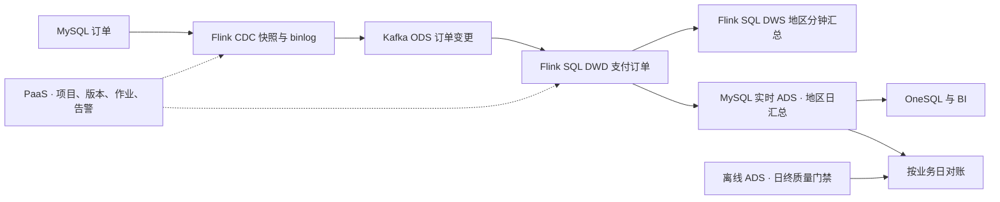

# 实时计算与实时数仓实施计划

维护者 **dkailab**。首个场景是地区成交额。沿用离线订单数仓的业务日、地域和金额口径，先用一张带主键的订单表验收从快照接入到实时结果再到日终对账的全链路。

## 可复现样例

从仓库根目录执行 `python3 examples/realtime-orders/verify.py`。需要 Python 3.9+、Docker Compose、curl、tar 和 shasum。脚本启动独立的 MySQL 8.0.46、Apache Kafka 3.9.1 和 Flink 1.20.3，下载并校验 Flink CDC 3.6.0 对应的工具和连接器。支持使用 `DK_CDC_CACHE` 复用已下载依赖。业务容器无需构建。默认在退出时清理独立测试项目的容器和卷，指定 `--keep` 可保留作业和测试数据。

准备脚本校验 CDC 与连接器的下载摘要，并将 MySQL JDBC 驱动装配到 CDC 命令行依赖目录。

日常回归可运行 `python3 examples/realtime-orders/verify.py --smoke`。它验证 CDC 初始快照和增量增删改写入后 DWD、DWS、ADS 与源表一致。完整命令另外覆盖 TaskManager 重启、旧事件回放、批流对账和窗口函数。

脚本验证初始快照、Kafka 订单主键及增删改消息，再根据源表重新计算预期结果，逐键比对 MySQL 的 `dwd_paid_orders`、`dws_region_minute`、`ads_region_day`。两个 Flink 作业建立 checkpoint 后，脚本暂停 TaskManager、提交新的源变更，随后启动 TaskManager，检查两个作业的已恢复 checkpoint 和最终数据。末尾将旧记录和重复更新重新送入同一消费分区，再核对订单状态和聚合。随后冻结源表快照，启动有界 Flink 批作业，并逐行比较批 ADS 和流 ADS。

| 文件 | 用途 |
| --- | --- |
| [compose.yml](../../examples/realtime-orders/compose.yml) | 隔离环境、共享 checkpoint 存储、内网连接。Flink REST 仅映射到本机随机端口。 |
| [orders-cdc.yaml](../../examples/realtime-orders/orders-cdc.yaml) | 只采集 `orders_source.orders`，将 Debezium JSON 输出到 `orders.ods.v1`。 |
| [warehouse.sql](../../examples/realtime-orders/warehouse.sql) | Flink SQL 从 ODS 计算 DWD 支付明细、DWS 地区分钟和 ADS 地区日汇总。 |
| [batch-reconcile.sql](../../examples/realtime-orders/batch-reconcile.sql) · [paid-order-views.sql](../../examples/realtime-orders/paid-order-views.sql) | 批模式读固定快照，与流模式复用支付明细及地区日汇总定义。 |
| [verify.py](../../examples/realtime-orders/verify.py) | 对账、源事件校验、真实重启和历史消息回放。 |

版本组合和 CDC 输出格式按 Flink CDC 官方手册配置。样例内的账号和密码用于隔离环境。 [Flink CDC MySQL 到 Kafka](https://nightlies.apache.org/flink/flink-cdc-docs-release-3.6/docs/get-started/quickstart-for-1.20/mysql-to-kafka/)

### 实时订单口径

- 以 `paid_epoch_ms`（UTC 毫秒）记录支付业务事件时间，统一按 Asia/Shanghai 切业务日和分钟。金额全程用整数分累加，避免浮点对账误差。
- 源订单主键保持稳定，每次变更递增 `change_version`。删除沿用最后一个版本号并在同版本优先。消费者按订单号保留最高版本，只计算最新状态为 `PAID` 的订单。源侧重用同一订单 ID 时必须延续版本号。生产接入其他表时需验证等价的顺序来源。
- 金额、地域、支付时间或支付状态变化会撤回旧贡献并增加新贡献。结果支持历史分钟的迟到更正，样例保留订单状态供更正与回放。生产化需明确迟到期限、状态容量和归档策略。
- DWD、DWS、ADS 分别按主键写入 MySQL，允许在 checkpoint 恢复时重放后收敛。三个输出表的更新可短暂错开，对账等待各表收敛。分钟口径上线时应区分实时修订值和日终确认值。

## 架构

Flink 执行长运行作业，持久化检查点与可恢复状态。Kafka 保留 ODS 变更供回放。Data Khaos 管理项目授权、配置版本、部署、观测、恢复和目录登记。离线调度器触发日终校验及重算，实时作业由 Flink 维护生命周期。首版使用 MySQL 服务实时 ADS。后续用吞吐、查询和可恢复性数据决定是否接入专用 OLAP 引擎。

## 分阶段开发

| 阶段 | 输入 | 输出 | 验收 |
| --- | --- | --- | --- |
| RT1 单表 CDC | MySQL 8 数据源引用、订单表、主键、初始快照模式、Kafka topic、checkpoint 配置 | Kafka ODS 订单变更、引擎作业 ID、快照进度和可用位点 | 样例验证快照、后续增删改和 checkpoint 重启，并逐主键比对。生产化补大表快照期间并发写入和 MySQL binlog 已清理后的人工恢复用例。 |
| RT2 实时数仓 | ODS 事件、支付状态规则、事件时间、水位线、业务时区 | DWD 订单变更、DWS 地区分钟汇总、实时 ADS 和滞后指标 | 变更重放、撤销支付、跨地区修改、迟到与重复事件均可复现。故障恢复后和离线金额、订单数对账。 |
| RT3 作业控制面 | 项目、SQL 或连接器配置版本、引擎集群 ID、资源配置、请求幂等键 | `deploymentId`、`engineJobId`、部署及恢复记录、监控告警 | 同键重复提交复用部署。同项目停机后从指定恢复点重启，越权请求被拒绝。 |
| RT4 查询及治理 | 实时 ADS、目录和血缘、指标口径、数据时效目标 | 数据地图入口、OneSQL/BI 查询、实时与日终对账 | 同时展示事件时间与结果更新时间。验证超时告警、问题追溯以及重算后结果收敛。 |

RT1 和 RT2 先用小型固定数据集验证引擎行为。RT3 再把实际验证过的操作纳入平台。样例已固定 Flink、Flink CDC 和连接器版本。CI 接入需给容器作业保留下载缓存和资源。采用 Flink CDC 的增量快照和 binlog 衔接，使用持久化 checkpoint 作为恢复输入。[Flink CDC MySQL 连接器](https://nightlies.apache.org/flink/flink-cdc-docs-stable/docs/connectors/flink-sources/mysql-cdc/)

## 数据和控制面契约

- **ODS**。样例使用 Debezium JSON 的 `source`、`op`、`before`、`after`，消息键为订单主键，业务事件时间和版本来自订单。MySQL 位点由 CDC checkpoint 管理，消费位点由 Kafka 分区偏移管理。生产契约再补采集时间、独立 schema 版本和可观测的源位点。位点失效后以新部署执行完整快照并核对。
- **DWD**。按订单主键维护最新状态，消费更新和删除。取消支付、金额或地域变化会撤回原贡献并写入新贡献。去重以源事件身份与顺序为准。
- **DWS / ADS**。粒度使用 `region + windowStart`，输出成交额、支付订单数、事件水位和更新时间。迟到处理与离线对账使用相同业务时区。MySQL 出口使用固定主键的 upsert，状态恢复允许重放并验证结果收敛。独立测试 sink 持久化行为后再决定交付语义。[Flink JDBC 表连接器](https://nightlies.apache.org/flink/flink-docs-stable/docs/connectors/table/jdbc/)
- **部署状态**。`SUBMITTED → RUNNING → STOPPING → STOPPED`。引擎可确认失败时进入 `FAILED`，提交或停止结果未知时标记 `RECONCILING` 并按原部署 ID 反查。checkpoint 用于自动恢复，显式保存的 savepoint 用于计划停机和兼容版本升级。控制面仅保留密钥引用。
- **候选验收目标**。首版用例的实时 ADS 更新延迟 p95 ≤ 60 秒，任务恢复后全量与离线聚合逐键一致。记录样本量、测试环境和 checkpoint 周期；生产目标根据压测再定。

查询实时 ADS 时先展示结果时效和引擎滞后。受管按日物化的版本属于离线发布，实时 ADS 刷新继续使用流作业检查点与结果更新时间。

流作业和批作业的 SQL、函数定义及历史版本由 [Flink 开发工作区](flink-studio.md) 管理。

## 事件时间开窗

订单现态口径继续使用可更正的分钟汇总。窗口示例使用独立的不可变支付事件，显式声明事件时间和一分钟水位延迟。内置验收依次比对一分钟滚动窗口、每分钟滑动的两分钟窗口，以及每分钟累加的两分钟累计窗口的 12 条输出。事件时间窗口的结果受 watermark 推进影响，过了窗口关闭时间的更正由离线对账或业务更正路径处理。 [窗口 SQL](../../examples/realtime-orders/window-demo.sql) · [Flink 窗口 TVF](https://nightlies.apache.org/flink/flink-docs-release-1.20/docs/dev/table/sql/queries/window-tvf/)

## 实时计算工作台

从门户进入「作业开发」打开 `/jobs`，在同一项目中访问 Flink SQL、离线工作流和 OneSQL。进入「实时运维」打开 `/realtime/operations`，查看实时运行与数仓产出。切页保留项目，顶部可以返回门户。历史地址 `/workflow/flink` 和 `/realtime/sql` 跳到 Flink SQL 作业，原 OneSQL 地址继续可用。

| 工作区 | 当前能力 | 下一步 |
| --- | --- | --- |
| 工作台首页 | 按当前项目查询 SQL 作业、JAR 作业和函数总数，区分读取失败与零资产。 | 汇总项目级运行和告警，按异常定位到作业实例。 |
| 开发与资产 | 流式和批处理 SQL 作业、版本存取、JAR 作业、固定版本函数依赖，SQL 编辑支持高亮和行号。 | 项目运行配置和逻辑表目录，提供隔离调试、执行计划和版本发布。 |
| 作业运维 | 按作业查看运行、检查点、保存点、吞吐、反压、Kafka 积压和水位线。调度动作沿用项目权限。 | 增加跨作业检索、回到告警来源、运行日志与产出影响。 |
| 实时数仓与 OneSQL | 工作区解释订单 ODS、DWD、DWS、ADS 路径，接到数据地图和数仓 API。OneSQL 查询已配置的结果库。版本化 ADS API 已支持实时结果时效及实时与批逐地区对账。 | 以项目目录表为起点开发，自动关联产出、运行、对账和数据服务。 |

阿里云案例用于对照开发、调试、发布和运维的作业生命周期。美团案例用于对照分层处理、复用公共汇总和面向业务的数据交付。 [阿里云实时计算 Flink 版](https://help.aliyun.com/zh/flink/realtime-flink/product-overview/what-is-alibaba-cloud-realtime-compute-for-apache-flink) · [美团实时数仓实践](https://tech.meituan.com/2018/10/18/meishi-data-flink.html)

### SQL 优先的下一次交付

先交付一个受管的订单 SQL 模板。管理员一次性配置项目的 Flink 环境、逻辑源表与目标表，以及各自的连接器、权限和默认并行度。开发者选择项目后编写业务 SQL，使用相同的业务查询和显式的流式或批执行配置。平台根据固定的配置版本解析逻辑表，在隔离环境校验 SQL 并预览有限结果，随后发布固定作业版本。运行记录关联 SQL 版本、运行配置版本、输入资产和输出资产。

首个验收使用同一组支付规则，对有界快照执行批处理，对 CDC 输入执行流处理。模拟迟到更正和故障恢复，核对两种模式按地区和业务日收敛。当前订单样例已复用流批业务 SQL 定义，生产作业仍需准备连接器和运行环境。OneSQL 是交互查询入口，部署 Flink 生产作业使用实时计算工作台的作业版本。两种入口通过共享资产目录和结果契约连接。

## 生产能力与验收顺序

对照阿里云实时计算 Flink 版、火山引擎流式计算 Flink 版和 Confluent Cloud for Apache Flink，先把订单链路做到可观测、可重放、可安全发布，再扩展引擎资源管理。 [阿里云 Flink](https://help.aliyun.com/zh/flink/realtime-flink/) · [火山引擎作业详情](https://docs.volcengine.com/docs/streaming-computing-flink-version/view-job-details?lang=zh) · [Confluent Flink 监控](https://docs.confluent.io/cloud/current/flink/operate-and-deploy/monitor-statements.html)

| 优先级 | 能力 | 当前进展与下一步验收 |
| --- | --- | --- |
| P0 | 作业监控与告警 | 已展示引擎状态、检查点、恢复证据，以及按执行节点汇总的吞吐、忙碌、空闲、反压和输入水位线。算子视图展示输入输出水位线和 Kafka 最大分区积压。已增加检查点连续失败告警、恢复记录和站内通知。已增加持续反压的触发与恢复，已增加按运行配置的 Kafka 积压告警及按需水位线停滞诊断。已增加水位线持续告警及按运行保留的采样历史。 |
| P0 | CDC 生产化 | 已有 MySQL 单表快照和增量验证。补多表路由、快照期间并发写入、表结构兼容策略和位点失效回填。验收新增兼容列、阻断破坏性变更、回放后逐键对账。 |
| P0 | 实时数仓交付 | 已有订单流批对账、事件时间开窗及版本化实时 ADS 时效响应。补质量告警、按业务日补算及结果发布，数据地图关联源表、作业、指标和运行记录。模拟迟到更正后核对线上结果和离线批次。 |
| P1 | 开发调试与发布 | 已有作业与函数版本、手动提交和保存点恢复。补隔离测试输入输出、版本差异、开发到生产晋级和回滚。用同一个作业版本在隔离环境验收，审批后晋级。 |
| P1 | 资源与成本 | 当前项目绑定专用集群。补队列、配额、状态存储用量和容量趋势，验证过载作业隔离后再评估自动扩缩容。 |

先按项目和作业运行 ID 采集一条订单作业的监控指标，验证 Kafka 积压、watermark 停滞、最新检查点失败三类场景能各自定位。数仓侧以地区支付金额和支付订单数为验收对象，记录业务日期、结果更新时间和对账差异。 [阿里云监控告警实践](https://help.aliyun.com/zh/flink/realtime-flink/user-guide/best-practices-for-monitoring-and-alerting) · [Flink CDC Schema 演进](https://nightlies.apache.org/flink/flink-cdc-docs-stable/docs/core-concept/schema-evolution/)
