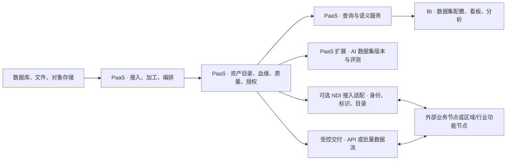

# Data Khaos 架构映射与验收

基于[技术文件摘要](README.md)和[项目架构](../architecture.md)。以下是项目设计建议，能力状态来自静态代码扫描。正式互通在明确对端角色、接口版本和联调范围后验收。

## 项目边界

PaaS 持有资产、权限决策和语义模型。BI 通过模型、查询及目录 API 使用资产，持有图表和仪表板。BI 数据集是分析配置，AI 数据集是具有内容版本、许可和评测证据的交付对象。两者可以引用共同的资产 ID。跨域接入适配先由 PaaS 托管，可独立部署时再评估分仓。接入端可逐步承担连接器或业务节点的相关职责，全域及区域/行业功能节点由对接方提供。

## 能力差距与归属

| 能力与条款 | 可复用实现 | 设计落点与验收证据 |
| --- | --- | --- |
| 身份与授权 · NDI-03 §6–9；NDI-02 §8 | auth、permission、approval、gateway 已提供平台内账号、权限和审批组成。 | PaaS 统一资产授权。接入适配管理外部主体、节点和连接器凭证与本地角色的绑定。联调验证凭证校验、撤销、跨组织最小授权和审计关联。 |
| 标识 · NDI-04 §4–7 | metadata 有内部表 ID 与血缘实体。 | 内部资产 ID 保持稳定，外部标识以独立映射保存对象类型、赋码来源、标识和状态。验证重复回调、存量映射、未知标识和撤销解析。 |
| 资源与产品目录 · NDI-02 §5–7；NDI-06 §5–8 | metadata 有库表目录、搜索、治理字典与血缘。 | 在 PaaS 管理资源、产品及版本，记录资源关联、登记审批、目录发布与撤销。外部 schema 与内部资产模型由适配层转换。验证字段完整、增量同步幂等、撤销可见性及目录字段的访问边界。 |
| 接入与交付 · NDI-05 §6–8；NDI-02 §8 | datasource 有 JDBC SPI。pipeline 有同步任务，workflow 有 DAG 运行路径。 | JDBC 作为存储访问能力复用。另设 NDI 接入适配承担认证、目录和交付。用一个受控 API 或批量交付场景验证授权、完整性、超时重试、交付记录和状态上报。 |
| 可见性和审计 · NDI-05 §8；NDI-03 §9 | query、mart、visual 各有部分权限检查，QueryService 有策略改写异常回退路径。 | 在 PaaS 收口表、行、列决策和日志。验证策略服务异常时拒绝，以及预览、导出、下钻、定时刷新和交付对同一授权范围的一致性。 |
| AI 数据集 · TC609 四份文件 | pipeline/workflow 支撑生产过程，metadata 支撑来源与血缘，dquality 支撑规则和质量快照。 | 新增数据集版本、内容清单、许可、分类、构建与标注证据，以及独立评测记录。以不可变版本关联任务 run ID 和产物摘要。验证无监督适用规则、格式失败、模型适配失败和三个门槛的独立判定。 |

代码入口见 [DataSourceConnector](../../data-khaos-datasource-api/src/main/java/com/datakhaos/datasource/api/connector/DataSourceConnector.java)、[MetadataService](../../data-khaos-metadata/src/main/java/com/datakhaos/metadata/service/MetadataService.java)、[QueryService](../../data-khaos-query/src/main/java/com/datakhaos/query/service/QueryService.java)、[DqSnapshot](../../data-khaos-dquality/src/main/java/com/datakhaos/dquality/entity/DqSnapshot.java)。

## 建设顺序

1. **平台底座**。先实现并验收订单批处理到 BI 的路径。串起内部资产 ID、运行 ID、质量快照和指标版本，统一查询与授权。验收时用不同权限的用户验证同一个图表和导出。
2. **目录与跨域演示**。新增资源/产品登记和外部标识映射，选定对端角色与接口版本。从一条目录发布到受控交付路径开始，收集双方联调与拒绝用例。保留同一资产的内部 ID，模拟环境用测试授权和合成数据。
3. **AI 数据集发布与评测**。选定目标模型并制作样例数据集版本，校验内容清单及许可。保存说明文档结果、数据质量报告和模型应用证据，用适用版本的规则独立计分。允许记录未完成评测及其缺失证据，发布状态和评测结论分别维护。

第一阶段对应现有 PaaS/BI 拆分。第二、三阶段可独立建设，复用同一个资产、授权及审计底座。项目未验证对端和验收报告前，发行说明使用具体能力描述。
